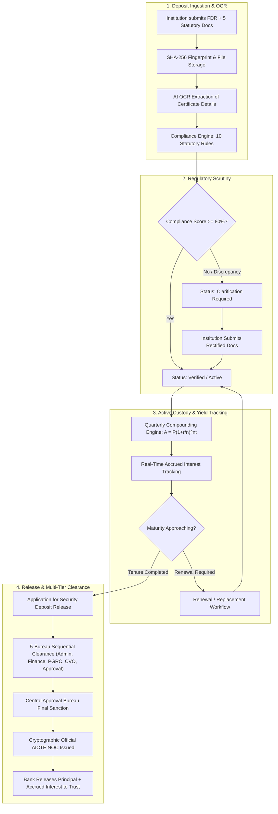

<div align="center">

# 🏛️ Niddhi Setu (निधि सेतु)
### AICTE Security Deposit & Fixed Deposit Receipt (FDR) Regulatory Management Platform

[](https://aicte-india.org)
[](https://react.dev/)
[](https://www.typescriptlang.org/)
[](https://nodejs.org/)
[](https://www.mongodb.com/)
[](https://expo.dev/)
[](https://tailwindcss.com/)

<p align="center">
  <b>A unified, tamper-evident regulatory platform tracking institutional Security Deposits and Fixed Deposit Receipts (FDRs) from initial submission, automated compliance verification, and joint lien custody to compound interest yield valuation and multi-tier clearance for lien discharge.</b>
</p>

[✨ Key Features](#-key-features) • [🏗️ System Architecture](#-system-architecture) • [📈 Financial Calculations & Yield](#-financial-yield--compound-interest-engine) • [🔄 Regulatory Lifecycle](#-fdr-regulatory-lifecycle) • [🚀 Quick Start](#-quick-start) • [📱 Mobile App](#-mobile-companion-app) • [🔑 Demo Credentials](#-demo-credentials) • [📡 API Guide](#-api-specification)

</div>

---

## 📌 Problem & Executive Summary

Technical education institutions affiliated with the **All India Council for Technical Education (AICTE)** are statutorily required to maintain Fixed Deposit Receipts (FDRs) / RPGF deposits as security guarantees in joint name with the Member Secretary, AICTE.

Traditionally, managing tens of thousands of paper-based certificates across commercial banks introduced:
- **Tenure Gaps & Untracked Renewals**: Overlooked 8-year maturities and rollover failures.
- **Verification Bottlenecks**: Heavy manual scrutiny required for bank branch endorsements, lien clauses, and financial values.
- **Disjointed Exit Clearance**: Delayed No Objection Certificates (NOC) and lien discharge when an academic program concludes.
- **Opaque Financial Yields**: Inability to calculate accrued compound interest, evaluate projected maturity amounts, or audit bank interest settlements.

**Niddhi Setu** solves these challenges through an integrated **Web Scrutiny Console** for AICTE regulators and a synchronized **Mobile Companion App** for institutions, backed by an automated compound interest engine, AI-powered OCR verification, and a 5-tier inter-departmental clearance orchestrator.

---

## ✨ Key Features

### 1. 💼 Statutory Deposit Ingestion & Verification
- **5-Document Statutory Dossier**: Multi-document ingestion including Official FDR Certificate, Institutional Application Letter, Sworn Affidavit 6, Bank Payment Proof, and latest AICTE Letter of Approval (LoA / EoA).
- **AI OCR Verification**: Automated extraction of certificate serial numbers, issuing bank/branch, principal amount, issue date, and maturity date with confidence scoring.
- **Cryptographic File Fingerprinting**: SHA-256 hash generation for every uploaded instrument to guarantee document integrity.
- **Compliance Rules Engine**: Automated verification against 10 statutory rules covering scheduled commercial bank status, joint lien endorsements, tenure validity, and certificate uniqueness.

### 2. 📈 Financial Yield & Compound Interest Engine
- **RBI Standard Compound Interest Formula**: Accurately computes quarterly compounded interest for institutional term deposits:
  $$\text{Maturity Value } A = P \times \left(1 + \frac{r}{n}\right)^{n \cdot t}$$
- **Real-Time Accrued Interest Tracking**: Dynamically tracks interest accumulated to date over the elapsed deposit tenure.
- **Statutory Yield Preview Wizard**: Interactive calculator in both web and mobile forms providing real-time valuation of Principal Under Lien, Effective Annual Yield (% p.a.), Projected Accrued Interest, and Total Maturity Value.
- **Interest Payout Model & TDS Transparency**: Handles cumulative reinvestment versus periodic payouts, factoring in trust tax exemption status (Section 12AA/12AB / Form 15G/15H / Section 197 nil TDS certificates).

### 3. 🏛️ Multi-Tier Inter-Departmental Clearance Orchestrator
- **5-Department Clearance Pipeline**:
  1. *Administrative Scrutiny Bureau*: Institutional status, land/building stability, enrollment audit.
  2. *Finance & Accounts Bureau*: Fee reconciliation, penalty checks, dues clearance.
  3. *Public Grievance Redressal Cell (PGRC)*: Student complaints, faculty dispute audit.
  4. *Chief Vigilance Office (CVO)*: Anti-corruption clearance, legal injunction check.
  5. *Approval Bureau / Member Secretary*: Final executive sanction.
- **Conditional Gating on NOC Release**: The official No Objection Certificate (NOC) remains locked until all 5 approvals are recorded.
- **Official AICTE NOC Order Generation**: Complete with council insignia, dynamic reference ID, bank directive clauses, and detailed financial particulars (Principal + Accrued Interest). Available for direct browser printing and native mobile PDF generation/sharing (`expo-print` & `expo-sharing`).

### 4. 📱 Mobile Companion App (React Native / Expo)
- **5-Tab Ergonomic Layout**: Home Dashboard, FDR Master Register, Centered Quick Upload, Clearance Workflows, and Institutional Profile.
- **Mobile Camera Document Scanner**: Direct photo capture and document picker for all statutory uploads.
- **Full Parity**: Live financial yield cards, maturity countdowns, scrutiny status alerts, and native PDF NOC printing.

---

## 🏗️ System Architecture

```
fdr-sentinel/
├── backend/                  # Node.js / Express REST API & Engine (Port 5000)
│   ├── src/
│   │   ├── config/          # Constants, database configs, RBAC matrices
│   │   ├── middleware/      # Auth (JWT), RBAC, Multer multipart upload
│   │   ├── models/          # Mongoose models: FDR, ClearanceWorkflow, User, etc.
│   │   ├── routes/          # API endpoints: fdrs, clearance, dashboard, auth, etc.
│   │   ├── services/        # Compliance engine, orchestrator, lineage service
│   │   └── utils/           # Financial calculations, seed data, cryptographic hashing
│   └── server.js            # Express server entry point
├── frontend/                 # React 18 + Vite + Tailwind CSS Web Portal (Port 5173)
│   ├── src/
│   │   ├── components/      # UI component library, Layout, Navigation
│   │   ├── pages/           # FDR Register, Detail, Clearance, Dashboard, Scrutiny
│   │   ├── types/           # TypeScript interfaces (FDR, ClearanceWorkflow, etc.)
│   │   └── utils/           # Formatters, currency conversion, constants
│   └── vite.config.ts
├── mobile/                   # React Native + Expo Mobile Companion App
│   ├── src/
│   │   ├── api/             # Axios client with automatic server discovery
│   │   ├── assets/          # Base64 AICTE insignia and graphics
│   │   ├── screens/         # Home, FDRList, Upload, Clearance, Profile
│   │   └── types/           # Mobile TypeScript interfaces
│   └── App.tsx              # Expo root with 5-tab navigation & header alerts
└── README.md
```

---

## 📈 Financial Yield & Compound Interest Engine

The platform incorporates an Indian CBS banking standard compound interest calculation module ([`financialCalculations.js`](file:///C:/Users/Shantanu/.gemini/antigravity/scratch/fdr-sentinel/backend/src/utils/financialCalculations.js)):

| Parameter | Default Value | Description |
| :--- | :--- | :--- |
| **Formula** | $A = P \times (1 + r/n)^{n \cdot t}$ | Standard quarterly compounding term deposit valuation |
| **Annual Rate ($r$)** | 7.10% p.a. | Contracted institutional term deposit rate (6.8% - 7.4% range) |
| **Compounding ($n$)** | 4 (Quarterly) | Standard frequency applied by Indian scheduled commercial banks |
| **Tenure ($t$)** | 8 Years / Custom | Prescribed statutory lock-in period |
| **Accrued Calculation** | $P \times (1 + r/4)^{4 \times (m / 12)}$ | Real-time yield accrued based on calendar months elapsed |
| **TDS Regime** | Exempt / 10% | Educational trust status under Section 12AA/12AB / Section 197 |

---

## 🔄 FDR Regulatory Lifecycle



---

## 🚀 Quick Start

### Prerequisites
- **Node.js**: v18.0.0 or higher
- **MongoDB**: Local instance running on `localhost:27017`
- **npm** or **pnpm**
- **Expo Go App** (optional, for testing mobile companion on iOS/Android)

---

### 1. Database Setup & Seeding

```powershell
cd backend
npm install
node src/utils/seed.js
```
*Seeds the database with 15 pre-configured FDRs with calculated maturity values, user roles, and clearance workflows.*

---

### 2. Run the Backend API Server

```powershell
cd backend
node server.js
```
*Server starts on `http://localhost:5000` (and on your local Wi-Fi IP for mobile access).*

---

### 3. Run the Web Portal

```powershell
cd frontend
npm install
npm run dev
```
*Open `http://localhost:5173` in your browser.*

---

### 4. Run the Mobile Companion App

```powershell
cd mobile
npm install
npm start
```
*Scan the generated QR code using the **Expo Go** app on your mobile device (connected to the same Wi-Fi).*

---

## 🔑 Demo Credentials

All test accounts share standardized staging passwords:

| Role | Email | Password | Scope / Jurisdiction |
| :--- | :--- | :--- | :--- |
| **Institution** | `registrar@iitd.ac.in` | `Inst@123` | Indian Institute of Technology Delhi |
| **Institution** | `registrar@nitt.edu` | `Inst@123` | NIT Tiruchirappalli |
| **Institution** | `finance@bits-pilani.ac.in` | `Inst@123` | BITS Pilani |
| **Admin Officer** | `admin.officer@aicte.gov.in` | `Officer@123` | Clearance Step 1: Administrative Scrutiny |
| **Finance Officer** | `finance.officer@aicte.gov.in` | `Officer@123` | Clearance Step 2: Financial Dues & Audit |
| **PGRC Officer** | `pgrc.officer@aicte.gov.in` | `Officer@123` | Clearance Step 3: Grievance Redressal |
| **CVO Officer** | `vigilance.officer@aicte.gov.in` | `Officer@123` | Clearance Step 4: Vigilance & Legal |
| **Approval Officer** | `approval.officer@aicte.gov.in` | `Officer@123` | Clearance Step 5: Final Sanction |
| **Central Admin** | `admin@aicte.gov.in` | `Admin@123` | AICTE Headquarters / Full Governance |

---

## 📱 Mobile Companion App

The Niddhi Setu mobile app provides on-the-go statutory oversight for registrars and finance directors:

<div align="center">

| Tab / View | Functionality |
| :--- | :--- |
| **🏠 Home** | Executive portfolio summary, total guarantee deposit, projected maturity value, and quick actions. |
| **📁 FDRs** | Master register of all deposits, bank names, branch IFSCs, principal, and calculated maturity values. |
| **📷 Upload** | Camera document scanner with instant OCR parsing, interest rate inputs, and live statutory yield preview. |
| **⚖️ Clearance** | Real-time multi-tier clearance tracking, interactive status pills, and unlocked official AICTE NOC orders. |
| **👤 Profile** | Institutional PID credentials, official contact channels, and secure biometric session settings. |

</div>

---

## 📡 API Specification

<details>
<summary><b>Click to expand full REST API endpoint directory</b></summary>

```http
### Authentication
POST   /api/auth/login                  # JWT issuance with role identification
GET    /api/auth/me                     # Current authenticated user profile

### Executive Overview & Financial Metrics
GET    /api/dashboard/summary           # Total deposits, active value, total maturity value, total accrued interest
GET    /api/dashboard/maturity-trend    # 12-month temporal timeline of incoming maturities
GET    /api/dashboard/recent-activity   # Live audit feed of regulatory actions

### Institution Management
GET    /api/institutions                # Filterable catalog of affiliated technical institutions
POST   /api/institutions                # Onboard new academic institution
GET    /api/institutions/:id            # Institute profile & authorized trustees
GET    /api/institutions/:id/fdrs       # Complete FDR catalog for given institute

### FDR Master Register
GET    /api/fdrs                        # Paginated deposit register (search by ref, bank, tenure)
POST   /api/fdrs                        # Submit new FDR with 5 statutory multipart attachments & interest rate
GET    /api/fdrs/:id                    # Comprehensive instrument dossier with yield breakdown
PATCH  /api/fdrs/:id/status             # Transition status (Submitted / Verified / Matured / Released)
GET    /api/fdrs/:id/lineage            # Predecessor rollover & renewal chain tree
GET    /api/fdrs/:id/findings           # Compliance rule audit breakdown

### Verification Queue & Case Management
GET    /api/verification/queue          # Instruments pending officer scrutiny
GET    /api/verification/cases/:id      # Detailed case file with OCR extraction comparison
PATCH  /api/verification/cases/:id/decision # Officer decision: Approve, Reject, Seek Clarification

### Interdepartmental Clearance Orchestrator
GET    /api/clearance/workflows         # List all clearance workflows with status/department filters
GET    /api/clearance/workflows/:id     # Full clearance dossier with 5-tier tasks & document verification
POST   /api/clearance/workflows/:id/documents/:docKey         # Upload/replace checklist document
PATCH  /api/clearance/workflows/:id/documents/:docKey/verify  # Verify/reject document with observations
PATCH  /api/clearance/workflows/:id/tasks/:taskKey/decision   # Record departmental clearance decision
GET    /api/clearance/bottlenecks       # Departmental turnaround times & SLA bottleneck metrics
GET    /api/clearance/workflows/:id/ai-recommendation         # Evidence-grounded AI recommendations
POST   /api/clearance/sla/escalate      # Trigger manual SLA escalation sweep (Admin only)

### Mobile & System Notifications
GET    /api/notifications               # Institution alert feed (maturities, remarks, sanction orders)
```

</details>

---

## 🔒 Security & Regulatory Architecture

- **Role-Based Access Control (RBAC)**: Strict segregation of duties across Institutional Trustees, Bureau Officers (Admin, Finance, PGRC, Vigilance, Approval), and Super-Admins.
- **Tenant Isolation**: Institutions are cryptographically scoped at the database query level and cannot inspect peer institutions' deposits.
- **Cryptographic Document Fingerprints**: Every certificate upload generates an automated SHA-256 fingerprint for tamper detection.
- **Append-Only Audit Ledger**: Statutory lifecycle actions are immutably logged and cannot be updated or deleted via API routes.
- **Transport Security**: Sanitized HTTP headers via Helmet, JWT session signing, and strict rate-limiting per IP.

---

<div align="center">
  <sub>Developed for AICTE Regulatory Modernization • Niddhi Setu Platform</sub>
</div>
