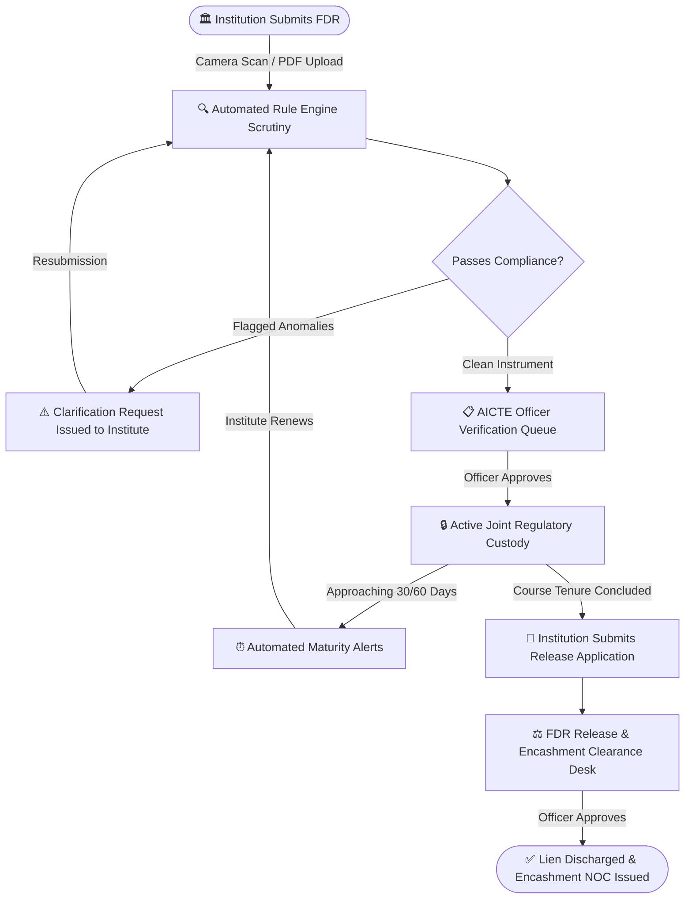

<div align="center">

# 🏛️ Niddhi Setu (निधि सेतु)
### AICTE Security Deposit & Fixed Deposit Receipt (FDR) Regulatory Management Platform

[](https://aicte-india.org)
[](https://react.dev/)
[](https://www.typescriptlang.org/)
[](https://nodejs.org/)
[](https://www.mongodb.com/)
[](https://expo.dev/)
[](https://tailwindcss.com/)

<p align="center">
  <b>A unified, tamper-evident regulatory platform tracking institutional Security Deposits and Fixed Deposit Receipts (FDRs) from initial submission, automated compliance verification, and joint lien custody to final release and encashment clearance upon course tenure completion.</b>
</p>

[✨ Key Features](#-key-features) • [🏛️ Architecture](#-system-architecture) • [🔄 Regulatory Lifecycle](#-fdr-regulatory-lifecycle) • [🚀 Quick Start](#-quick-start) • [📱 Mobile App](#-mobile-companion-app) • [🔑 Demo Credentials](#-demo-credentials) • [📚 API Guide](#-api-specification)

</div>

---

## 📌 Problem & Executive Summary

Technical education institutions affiliated with the **All India Council for Technical Education (AICTE)** must deposit Fixed Deposit Receipts (FDRs) as statutory security guarantees during institutional establishment and program approvals. 

Traditionally, managing tens of thousands of paper-based certificates across hundreds of scheduled banks introduces:
- **Tenure Gaps & Untracked Renewals**: Overlooked maturities and rollover failures.
- **Verification Bottlenecks**: Heavy manual scrutiny required for bank branch endorsements and lien clauses.
- **Disjointed Exit Clearance**: Delayed NOC and lien release when an academic program concludes.

**Niddhi Setu** bridges this governance gap by offering an integrated **Web Scrutiny Console** for AICTE regulators and a dedicated **Pocket Mobile Companion** for affiliated institutions.

---

## 🏛️ System Architecture

```
Niddhi-Setu/
├── backend/          # Express.js REST API & Compliance Engine (Port 5000)
├── frontend/         # React + Vite + TypeScript Web Scrutiny Portal (Port 5173)
├── mobile/           # React Native / Expo Mobile App for Technical Institutions
└── README.md
```

### 👥 Role & Channel Segregation

| Channel | Intended Audience | Key Responsibilities |
| :--- | :--- | :--- |
| **Web Portal** | AICTE Officers & Administrators | National dashboard, automated verification queue, instrument relationship graphing, compliance radar, encashment sanctioning, and audit logging. |
| **Web Portal** *(Limited)* | Technical Institutions | Desk submission of bulk deposits, renewal documentation, and statutory reporting. |
| **Mobile App** | Technical Institutions *(Registrars / Finance)* | Direct phone camera certificate scanning, real-time maturity countdowns, instant scrutiny notifications, and 1-tap release clearance requests. |

---

## 🔄 FDR Regulatory Lifecycle



> [!IMPORTANT]
> **Distinct Lifecycle Streams**: The **Verification Queue** evaluates *new* incoming deposits entering custody. The **Release & Encashment Desk** manages *concluding* deposits at the end of their multi-year academic tenure.

---

## ✨ Key Features

### 1. 🔍 Automated Scrutiny & Rule Engine
- **Deterministic Rule Base (`RULE_001` - `RULE_009`)**: Validates mandatory joint name mandates (`AICTE & Institution`), minimum tenure periods, authorized scheduled bank codes, and interest rollover directives.
- **Compliance Radar**: Real-time 6-axis compliance score (starts at 100 with weighted deductions for critical, high, and medium anomalies).

### 2. 🕸️ Instrument Relationship Graph (`/graph`)
- Interactive canvas rendering institution-to-deposit hierarchies:
  - 🟣 **Institutions** → 🔵 **FDR Instruments** → 🟢 **Renewals** → 🟡 **Verification Cases** → 🟢 **Clearance Actions**.
  - Built-in topological detection flags suspicious circular references, cross-institutional duplicate deposit numbers, and orphaned renewals.

### 3. ⏳ Temporal Lineage Explorer (`/lineage`)
- Chronological timeline tracking predecessor-to-successor transitions over multi-decade lifecycles.
- Automatically flags tenure gaps, amount regressions, and unauthorized bank migrations between roll-overs.

### 4. 🔏 Sealed Verification Passport (`/passport/:caseId`)
- Tamper-evident evidence packet binding original document fingerprints, extracted data points, officer timestamps, and decisions into an immutable, append-only event log.

### 5. 📱 Institutional Mobile Companion
- Instant physical deposit capture using mobile camera with edge cropping.
- Push-synchronized notifications for scrutiny requests, maturity countdowns, and clearance approvals.

---

## 🚀 Quick Start

### 📋 Prerequisites
- **Node.js** v18+ & **npm**
- **MongoDB** (local at `mongodb://localhost:27017` or MongoDB Atlas URI)
- **Expo Go** app on your iOS or Android phone (SDK 58)

---

### Step 1: Clone & Install Dependencies

```bash
# Clone the repository
git clone https://github.com/shantanupatil2806-tech/Niddhi-Setu.git
cd Niddhi-Setu

# Install Backend dependencies
cd backend && npm install

# Install Frontend dependencies
cd ../frontend && npm install

# Install Mobile dependencies
cd ../mobile && npm install
```

---

### Step 2: Configure Environment

Create `.env` inside `backend/`:
```bash
cd ../backend
cp .env.example .env
```
*(Default settings point to `mongodb://localhost:27017/fdr-sentinel` and port `5000`)*

---

### Step 3: Seed Synthetic Demo Data

Populate the database with test institutions, active deposits, compliance cases, and audit histories:
```bash
npm run seed
```

---

### Step 4: Run Web Portal & API Services

```bash
# Terminal 1 — Backend API Service
cd backend
npm run dev

# Terminal 2 — Frontend Web Portal
cd frontend
npm run dev
```

🌐 **Web Scrutiny Portal**: [http://localhost:5173](http://localhost:5173)  
🔌 **Backend Health Gateway**: [http://localhost:5000/api/health](http://localhost:5000/api/health)

---

### Step 5: Launch Mobile App on Physical Device

1. Make sure your smartphone and PC are connected to the **same Wi-Fi network**.
2. Find your local Wi-Fi IPv4 address (`ipconfig` on Windows or `ifconfig` on macOS/Linux).
3. Ensure `mobile/src/api/client.ts` points to your machine's IP (e.g. `http://192.168.1.35:5000/api`).
4. Start the Expo bundler:
```bash
cd mobile
npm start
```
5. Scan the QR code using the **Expo Go** application on your phone.

---

## 🔑 Demo Credentials

| Role | Organization / Department | Login Email | Password |
| :--- | :--- | :--- | :--- |
| **System Administrator** | AICTE HQ New Delhi | `admin@fdrsentinel.gov.in` | `Admin@123` |
| **Regulation Officer 1** | Bureau of Approval | `officer.sharma@fdrsentinel.gov.in` | `Officer@123` |
| **Regulation Officer 2** | Finance & Scrutiny | `officer.verma@fdrsentinel.gov.in` | `Officer@123` |
| **Institute Registrar** | IIT Delhi | `registrar@iitd.ac.in` | `Inst@123` |
| **Institute Registrar** | NIT Trichy | `registrar@nitt.edu` | `Inst@123` |
| **Institute Finance Lead** | BITS Pilani | `finance@bits-pilani.ac.in` | `Inst@123` |

*(The Mobile and Web login screens feature 1-tap quick presets for instant evaluation).*

---

## 📱 Mobile Companion App

<div align="center">

| Screen | Focus & Functionality |
| :--- | :--- |
| **Dashboard (Home)** | Institutional deposit aggregate sum, active guarantees, and pending scrutiny counter. |
| **Deposit Register (FDRs)** | Pocket dossier of all deposits, bank branch codes, and maturity countdowns. |
| **Deposit Intake (Upload)** | Camera scanner and document picker with immediate validation submission. |
| **Regulatory Alerts** | Scrutiny remarks, 30-day maturity notices, and sanction decisions. |
| **Profile** | Affiliation credentials, nodal officer identity, and secure session management. |

</div>

---

## 📚 API Specification

<details>
<summary><b>Click to expand full REST API endpoint directory</b></summary>

```http
### Authentication
POST   /api/auth/login                  # JWT issuance with role identification
GET    /api/auth/me                     # Current authenticated profile

### Executive Overview
GET    /api/dashboard/summary           # Total deposits, active value, pending verifications
GET    /api/dashboard/maturity-trend    # Temporal timeline of incoming maturities
GET    /api/dashboard/recent-activity   # Live stream of council actions
GET    /api/dashboard/compliance-distribution

### Institution Management
GET    /api/institutions                # Filterable list of affiliated technical colleges
POST   /api/institutions                # Onboard new academic institution
GET    /api/institutions/:id            # Institute profile & authorized trustees
PATCH  /api/institutions/:id            # Update accreditation / trust metadata
GET    /api/institutions/:id/fdrs       # Complete FDR catalog for given institute

### FDR Master Register
GET    /api/fdrs                        # Paginated deposit register (search by ref, bank, tenure)
POST   /api/fdrs                        # Submit new FDR certificate (multipart document upload)
GET    /api/fdrs/:id                    # Comprehensive dossier for single deposit
PATCH  /api/fdrs/:id/status             # Transition status (Active / Matured / Encashment)
GET    /api/fdrs/:id/lineage            # Predecessor & renewal chain tree
GET    /api/fdrs/:id/findings           # Compliance rule audit breakdown

### Verification Queue
GET    /api/verification/queue          # Unverified instruments pending officer review
GET    /api/verification/cases/:id      # Detailed scrutiny case packet
PATCH  /api/verification/cases/:id/decision # Officer decision: Approve, Reject, Seek Clarification
POST   /api/verification/cases/:id/findings # Attach manual inspection notes

### Evidence Passport & Graph
GET    /api/passport/:caseId            # Sealed verification passport packet
GET    /api/passport/:caseId/integrity  # Audit log tamper check
GET    /api/graph/institution/:id       # Visual node tree for institute
GET    /api/graph/fdr/:id               # Subgraph for specific deposit

### Release & Encashment
GET    /api/releases                    # Active encashment clearance applications
POST   /api/releases                    # Institute applies for lien discharge
GET    /api/releases/:id                # Clearance dossier & inspection history
PATCH  /api/releases/:id/decision       # Sanction release or reject application

### Mobile Notifications
GET    /api/notifications               # Institution alert feed (maturities, remarks, approvals)

### Governance & Reports
GET    /api/reports/export              # Excel/CSV audit export
GET    /api/reports/admin/audit-log     # Append-only chronological system audit trail
```

</details>

---

## 🛡️ Security & Privacy Architecture

- **Role-Based Access Control (RBAC)**: Strict separation of privileges across Admin, Scrutiny Officer, and Institution roles.
- **Tenant Isolation**: Institutions are cryptographically scoped at the API query level and can never inspect peer institutions' deposits.
- **Cryptographic Document Fingerprints**: Every certificate upload generates an automated SHA-256 fingerprint for tamper detection.
- **Append-Only Event Ledger**: Audit events cannot be updated or deleted via API routes.
- **Transport Security**: Sanitized HTTP headers via Helmet, JWT session signing, and strict rate-limiting per IP.

---

## 📄 Disclaimers

- *This platform is an academic engineering prototype developed for the Smart India Hackathon (SIH) under the AICTE Problem Statement.*
- *Banking checks demonstrate rule-based heuristics and automated receipt analysis; live bank core API integration requires RBI-approved Open Banking gateway access.*

---

<div align="center">
  <sub>Developed for AICTE Regulatory Modernization • Smart India Hackathon</sub>
</div>
